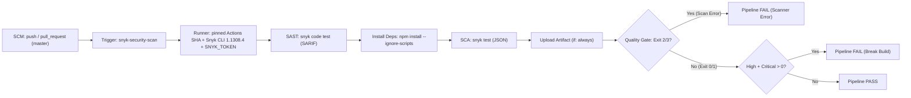

# CI/CD Security Scanning & Reporting (Snyk + GitHub Actions)

> **Forked Target Application:** [OWASP Juice Shop](https://github.com/juice-shop/juice-shop) (Intentionally vulnerable application for DevSecOps security testing)  
> **Security Note:** แอปพลิเคชันนี้มีช่องโหว่โดยเจตนา ห้าม Deploy ขึ้นเซิร์ฟเวอร์ที่เปิดสู่ Internet สาธารณะ

โปรเจกต์นี้ติดตั้ง Automated Security Scanning ด้วย **Snyk CLI** เข้าไปใน **GitHub Actions** ตั้งแต่ขั้นตอน `SCM → Trigger → Runner → Result & Quality Gate` พร้อมจัดทำรายงานเชิงเทคนิคและสรุปผู้บริหารจากผลสแกนจริง

---

## 1. Pipeline Architecture



---

## 2. โครงสร้าง Repository (Deliverables)

```text
.
├── .github/workflows/security-scan.yml   # Pipeline YAML (SAST + SCA + Quality Gate)
├── results/
│   ├── fail/                             # ผลสแกนจริงจาก Fail Run (#1)
│   │   ├── snyk-code.sarif
│   │   └── snyk-sca.json
│   └── pass/                             # ผลสแกนจริงจาก Pass Run (#2)
│       ├── snyk-code.sarif
│       └── snyk-sca.json
├── evidence/
│   ├── run-fail.png                      # ภาพหน้าจอรอบ Gate Fail
│   ├── run-pass.png                      # ภาพหน้าจอรอบ Gate Pass
│   └── logs/
│       ├── run-fail.txt                  # Raw log ของ Fail Run
│       └── run-pass.txt                  # Raw log ของ Pass Run
├── report/
│   ├── technical-report.md               # รายงานเชิงเทคนิค (ข้อ 2.1)
│   └── executive-summary.pdf             # สรุปสำหรับผู้บริหาร 1 หน้า (ข้อ 2.2)
└── README.md
```

---

## 3. วิธีตั้งค่า Secret และวิธีรัน

### การตั้งค่า (Prerequisites)
1. **เปิดใช้งาน Snyk Code (SAST):** เข้าเว็บ [Snyk](https://app.snyk.io) → `Settings` → `Snyk Code` → กด **Enable Snyk Code**
2. **ตั้งค่า CI Secret:** เข้า GitHub Repository → `Settings` → `Secrets and variables` → `Actions` → สร้าง Secret ชื่อ **`SNYK_TOKEN`** โดยใส่ Snyk API Token
   - *กฎความปลอดภัย:* ไม่มีการ hardcode secret/token ในโค้ดหรือไฟล์ YAML และไม่พิมพ์ค่า token ออกใน log
   - Snyk CLI อ่านค่าจาก environment variable `SNYK_TOKEN` โดยอัตโนมัติ

### การรัน Pipeline (CI & Local)
- **บน GitHub Actions:** ทำงานอัตโนมัติเมื่อ `push` หรือเปิด `pull_request` เข้า branch `master`
- **ทดสอบบนเครื่อง Local (Optional):**
  ```bash
  snyk auth
  snyk code test
  npm install --ignore-scripts
  snyk test
  ```

---

## 4. เกณฑ์ Quality Gate และเหตุผลการออกแบบ

1. **เกณฑ์ Gate ที่เลือก:** Pipeline จะ **Fail (`exit 1`)** ทันทีเมื่อพบช่องโหว่ระดับ **High หรือ Critical ≥ 1 รายการ** (รวมทั้ง SAST High และ SCA Critical/High) หรือเมื่อ Scanner ทำงานล้มเหลว
2. **การแยก Exit Code ของ Snyk (`0, 1, 2, 3`):**
   - `0` = สแกนสำเร็จ ไม่พบช่องโหว่
   - `1` = สแกนสำเร็จ **พบช่องโหว่**
   - `2` / `3` = **สแกนล้มเหลว** (เช่น ปัญหา network, token, config หรือไม่พบโปรเจกต์)
   - ใช้รูปแบบ `snyk ... || EXIT_CODE=$?` เพื่อป้องกัน Bash (`set -e`) หยุดทำงานกลางคันก่อนสแกนตัวถัดไปและก่อนอัปโหลด artifact จากนั้นส่งค่าผ่าน `$GITHUB_OUTPUT` ให้ step `Quality Gate` แยกตรวจ **Scan Error (`!= 0 && != 1`)** ก่อนนับช่องโหว่
3. **การสแกนแบบไม่กรองในขั้น Scanner:**
   - รัน `snyk code test` และ `snyk test` โดยไม่ใส่ `--severity-threshold=high` เพื่อให้ไฟล์ `.sarif` และ `.json` เก็บข้อมูลครบทุกความรุนแรง (`Critical / High / Medium / Low`) สำหรับนำไปวิเคราะห์ในรายงานข้อ 2 แล้วให้ step `Quality Gate` ใช้ `jq` นับเฉพาะ High/Critical เพื่อตัดสินผลการ build
4. **การอัปโหลดหลักฐานเสมอ:**
   - Step `Upload results` ใช้ `if: always()` เพื่อให้ดาวน์โหลดผล `.sarif` และ `.json` ได้แม้ Pipeline จะ Fail
5. **Supply-Chain & Runner Security Hygiene:**
   - จำกัด `permissions: contents: read` (Least Privilege)
   - Pin เวอร์ชัน `SNYK_VERSION: 1.1308.4` (ไม่ใช้ `latest`) และ Pin 40-char **Commit SHA** สำหรับ GitHub Actions ทุกตัว (`actions/checkout`, `actions/setup-node`, `actions/upload-artifact`)
   - ใช้ `npm install --ignore-scripts` ก่อนรัน `snyk test` เนื่องจาก `.npmrc` ของ Juice Shop ตั้ง `package-lock=false` (ไม่มี lockfile) จึงต้องสร้าง `node_modules/` ให้ SCA ไล่ dependency tree ได้ครบ โดย `--ignore-scripts` ช่วยป้องกันไม่ให้ lifecycle scripts ทำงานใน CI และวางไว้หลัง SAST เพื่อไม่ให้ `snyk code test` สแกน `node_modules/`

---

## 5. หลักฐานการทดสอบจริง (Pass & Fail Runs)

| ประเภท Run | Trigger / Branch | ผลลัพธ์ (Blocking Findings) | ลิงก์ Run จริง | หลักฐานใน Repo |
| :--- | :--- | :---: | :--- | :--- |
| **Fail Run (`#1`)** | `push` เข้า `master` | **FAIL** — `68` จุด (SAST High `27`, SCA Critical `1`, SCA High `40`) | [Run #1](https://github.com/Nadea13/juice-shop/actions/runs/44149802222) | [run-fail.png](evidence/run-fail.png) · [run-fail.txt](evidence/logs/run-fail.txt) |
| **Pass Run (`#2`)** | `pull_request` (`test/pass-run` → `master`) | **PASS** — `0` จุด (SAST `0`, SCA `0`) | [Run #2](https://github.com/Nadea13/juice-shop/actions/runs/44174595712) · [PR](https://github.com/Nadea13/juice-shop/pull/1) | [run-pass.png](evidence/run-pass.png) · [run-pass.txt](evidence/logs/run-pass.txt) |

### วิธีทำให้ Pass Run ผ่าน (โดยไม่ปิด Gate)
- สร้าง branch แยกชื่อ `test/pass-run` โดยคงไฟล์ `.github/workflows/security-scan.yml` ไว้ **เหมือนเดิมทุกบรรทัด** (ไม่ได้ปิด Quality Gate หรือแก้ให้ `exit 0` เสมอ)
- เปลี่ยนโค้ดตัวอย่างเฉพาะใน branch ทดสอบนั้นเป็นแอป Node.js ขนาดเล็กที่สะอาด (`index.js` + `package.json` ที่มี dependency `ms@2.1.3` ที่ไม่มีช่องโหว่) แล้วเปิด Pull Request เข้า `master`
- PR ดังกล่าวถูกเก็บไว้เป็นหลักฐานการทดสอบโดย **ไม่ Merge** เข้า `master` เพื่อให้โค้ดหลักยังคงเป็น OWASP Juice Shop ตามเดิม

---

## 6. ข้อจำกัดที่ทราบ (Known Limitations)

1. **ขอบเขตของ SCA:** `snyk test` สแกนเฉพาะ root `package.json` (631 dependencies) ยังไม่ได้รวม `frontend/package.json` (สามารถขยายได้ในอนาคตด้วย `--all-projects`)
2. **ระดับความรุนแรงของ Snyk Code:** Snyk Code (SAST) แบ่งระดับสูงสุดที่ `High` (`level: "error"` ใน SARIF) โดยไม่มีระดับ `Critical`
3. **เกณฑ์การนับใน SCA:** Quality Gate นับตามจำนวน vulnerable paths ใน `.vulnerabilities[]` (110 paths / 41 High+Critical paths) ซึ่งอาจมากกว่าจำนวน unique vulnerability IDs (68 unique / 25 High+Critical unique) เมื่อมี dependency ซ้อนทับกันหลายเส้นทาง

---

## 7. รายงานผลสแกน (Security Reports)

- **Technical Report (สำหรับทีมพัฒนาและ Security):** [report/technical-report.md](report/technical-report.md)
- **Executive Summary (สำหรับผู้บริหาร — 1 หน้า):** [report/executive-summary.pdf](report/executive-summary.pdf)

---

## 8. การใช้งาน AI Assistant (AI Disclosure)

ใช้ AI Assistant ช่วยในส่วนต่อไปนี้ และได้ตรวจสอบ ทำความเข้าใจ และทดสอบทุกขั้นตอนด้วยตนเองแล้ว:
- อธิบายแนวคิดการจัดการ Snyk CLI exit codes (`0, 1, 2, 3`) และการจับ output ข้าม step ด้วย Bash ใน GitHub Actions
- ช่วยตรวจสอบ syntax ของไฟล์ `.github/workflows/security-scan.yml` และแนวทางการ pin Commit SHA
- ช่วยสกัดข้อมูลสถิติจากไฟล์ผลสแกนจริง (`.sarif` / `.json`), เขียนสคริปต์สร้างกราฟ, และช่วยร่างโครงสร้างรายงานใน `report/technical-report.md`, `report/executive-summary.pdf`, และ `README.md`
